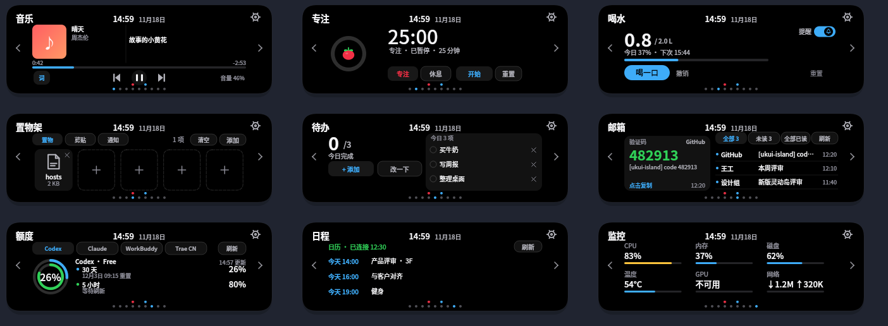
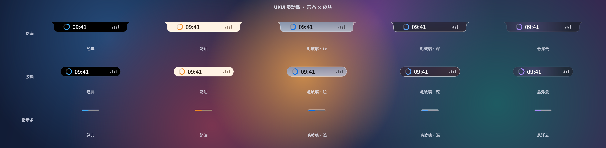

# UKUI 灵动岛

这是给银河麒麟 V10 SP1 和 UKUI 桌面做的顶边灵动岛。收起时贴在屏幕顶部，显示时间、系统状态和待处理事项。鼠标移上去展开成 420×140 的面板，移开自动收起。

项目用 Python 3.8 和 PySide2 5.15 写，安装包自带 Qt 和 Python 运行时，装好后不用再配 Python 环境。当前版本 0.6.0，只支持 X11 会话。



## 功能

- 收起态显示时钟、日期、电量、天气、CPU/内存环和状态块。待办、专注、邮件、饮水提醒会在对应状态出现，没有电池的设备自动隐藏电量。
- 外观可以选刘海、胶囊或指示条，皮肤有经典、奶油、毛玻璃·浅、毛玻璃·深和悬浮云五种，形态和皮肤可以自由组合。
- 展开面板有九个页面：音乐、专注、健康、置物架、待办、邮箱、AI 额度、日程、监控。左右箭头、底部页码豆和滚轮都能切页。
- 音乐页通过 MPRIS 读取播放器，显示封面、进度、音量和同步歌词，支持播放控制与拖动进度。
- 待办支持每天、工作日、指定星期重复和 HH:MM 提醒。另有番茄专注、饮水记录、剪贴板历史（最多 30 条）和文件置物架。
- 置物架支持从文件管理器拖入文件，只记录路径，不复制文件。
- 邮箱使用 IMAP 轮询，识别验证码，可复制、标已读/未读和删除。写操作默认关闭，开启后才会同步到服务器。
- 日程支持本地 `.ics`、HTTP(S) `.ics` 和 CalDAV。
- AI 额度页显示 Codex、Claude、WorkBuddy、Trae CN 和 Copilot 的本地用量，也可以配置自定义 JSON 地址。在线官方额度默认关闭，开启后只把本机登录令牌发给对应官方域名。
- 收起态和额度页会显示 Codex、Claude 的实时回合状态，包括思考、执行、回答和完成。
- 系统监控显示 CPU、内存、磁盘、温度、网络速率和 NVIDIA GPU 占用。数据来自 `/proc`、`statvfs` 和 `hwmon`。
- 托盘菜单可切换皮肤和形态，也能开关开机自启、全屏隐藏和鼠标穿透。

## 形态与皮肤



图里是 15 种形态和皮肤组合。

提醒状态见 [提醒状态矩阵](screenshots/reminder-matrix.png)。

## 系统要求

- 银河麒麟 V10 SP1，UKUI 桌面，X11 会话，x86_64。
- 当前发布包只有 x86_64/amd64；arm64 构建脚本已加入，尚未在真机验证。
- 已在 1920×1080 单屏上验证。其他分辨率和多屏环境未测试。
- 音量控制需要 `pactl` 或 `amixer`。电池从 `/sys/class/power_supply` 读取。
- 通知监听需要 `dbus-monitor`，全屏检测和毛玻璃探测需要 `xprop`。
- NVIDIA GPU 监控需要 `nvidia-smi`，其他显卡不显示 GPU 数据。

## 安装

### deb 包

```bash
sudo dpkg -i ukui-island_0.6.0_amd64.deb
sudo apt -f install
ukui-island
```

安装后可以从应用菜单打开「UKUI 灵动岛」。卸载命令：

```bash
sudo apt remove ukui-island
```

### 便携包

```bash
mkdir -p ~/apps/ukui-island
tar -xzf ukui-island-0.6.0-x86_64.tar.gz -C ~/apps/ukui-island
~/apps/ukui-island/run.sh
```

便携包里的 `install.sh` 会安装到 `~/.local/share/ukui-island`，并在 `~/.local/bin` 和用户应用菜单里创建入口。

### 从源码运行

```bash
python3 -m venv .venv
.venv/bin/pip install "PySide2==5.15.2.1" "jeepney>=0.8"
.venv/bin/python run.py
```

Python 3.8 是打包和验证使用的版本。系统缺少 Qt 运行库时，先安装 `libxcb-cursor0`、`libxkbcommon-x11-0`、`libgl1`、`libegl1`、`libdbus-1-3` 和 `fonts-noto-cjk`。

## 构建

```bash
./packaging/build.sh
ls -lh out/
```

脚本会创建 `.build-venv`，安装 PySide2 5.15.2.1、PyInstaller 6.11.1 和 jeepney，然后生成：

- `out/ukui-island_0.6.0_amd64.deb`
- `out/ukui-island-0.6.0-x86_64.tar.gz`
- `out/SHA256SUMS.txt`

打包目录在 `dist/ukui-island/`，可以直接运行自检：

```bash
QT_QPA_PLATFORM=offscreen dist/ukui-island/ukui-island --self-test
```

发布前检查：

1. `dpkg-deb -I out/ukui-island_0.6.0_amd64.deb` 的 `Depends` 与 `ldd dist/ukui-island/ukui-island` 的结果对得上。
2. 从解包后的 `/opt/ukui-island` 目录运行 `--self-test`，不要只跑 `dist/`。
3. 在没有 `~/.config/ukui-island` 的账户下启动一次。
4. 把 deb、tar.gz 和 `SHA256SUMS.txt` 一起上传到 Releases。

### ARM

arm64 包在 `ubuntu-22.04-arm` runner 上用 Debian bullseye 的 PySide2 5.15.2 构建。本地构建需要 arm64 机器：

```bash
./packaging/build-arm64.sh
```

产物在 `out-arm64/`：

- `out-arm64/ukui-island_0.6.0_arm64.deb`
- `out-arm64/ukui-island-0.6.0-aarch64.tar.gz`
- `out-arm64/SHA256SUMS.txt`

发布流水线在 `.github/workflows/release.yml`。推 `v*` tag 后会同时构建 amd64 和 arm64，并创建 Release。arm64 job 需要仓库能用 `ubuntu-22.04-arm` runner。这条路径还没有在麒麟 ARM 真机上验证。

## 使用

- 鼠标移到岛上展开，移开收起。展开后可用左右箭头、底部页码豆或滚轮切页。
- 点击托盘图标切换展开状态；右键打开皮肤、形态、开机自启、鼠标穿透和退出菜单。
- 设置窗口可改皮肤、形态、时间格式、天气城市、邮件、日历和额度。
- `ukui-island --version` 输出版本，`ukui-island --self-test` 输出 JSON 自检结果。

## 数据与卸载

| 内容 | 位置 |
| --- | --- |
| 配置 | `~/.config/ukui-island/config.json`（0600） |
| 待办、饮水、剪贴板、置物架 | `~/.local/state/ukui-island/productivity.json`（0600） |
| 日志 | `~/.local/state/ukui-island/island.log` |
| 开机自启 | `~/.config/autostart/ukui-island.desktop`（仅勾选时创建） |
| 已连接账号的令牌 | `~/.config/ukui-island/*.json`（0600） |

升级时直接安装新版本的 deb，程序目录会被覆盖，用户配置保留。回滚时安装上一个版本的 deb。配置解析失败会自动回退默认值，不会阻止启动。

彻底清理用户数据：

```bash
rm -rf ~/.config/ukui-island ~/.local/state/ukui-island
```

便携包安装到用户目录时，再删除 `~/.local/share/ukui-island`、`~/.local/bin/ukui-island` 和 `~/.local/share/applications/ukui-island.desktop`。

## 网络与隐私

程序不上报遥测。会联网的地方有：

- 天气：`wttr.in`，15 分钟缓存，断网时显示旧数据。
- 歌词：`music.163.com`，播放时按歌名和时长查询。
- 邮件、日历和自定义额度：只在设置里填了地址或账号后访问。
- 在线官方额度：默认关闭，开启后只访问对应的官方域名，12 秒超时，不跟随重定向。

配置、待办和登录令牌都留在本机。日志不记录邮件正文、账号密码或剪贴板内容。

## 验证范围

在 Kylin V10 SP1 / UKUI / X11 / 1920×1080 上验证过安装包解包运行、便携包启动、顶边显示和悬停展开。九个页面的切换、置物架拖放、QQ 和企业邮箱 IMAP 登录、Codex/Copilot 本机额度读取、通知监听也都实际试过。

以下项目还没验证：

- 纯净系统。依赖列表来自开发机。
- Wayland 会话、多屏和侧边停靠。
- CalDAV 和部分在线额度。没有用真实账号完成联调，失败时会回退本地数据。
- 连续运行 24 小时、内存曲线、代码签名和自动更新。
- 毛玻璃。取决于窗口管理器是否支持 `_KDE_NET_WM_BLUR_BEHIND_REGION`，不支持时使用静态半透明，没有实时模糊。

## 开发与测试

`.build-venv` 由 `packaging/build.sh` 创建。只想跑测试的话，也可以手动建：

```bash
/usr/bin/python3 -m venv .build-venv
.build-venv/bin/pip install "PySide2==5.15.2.1" "jeepney>=0.8"
```

然后运行：

```bash
.build-venv/bin/python tests/test_core.py
QT_QPA_PLATFORM=offscreen .build-venv/bin/python tests/smoke_offscreen.py
QT_QPA_PLATFORM=offscreen .build-venv/bin/python tests/pages-matrix.py
QT_QPA_PLATFORM=offscreen .build-venv/bin/python tests/reminder-matrix.py
QT_QPA_PLATFORM=offscreen /usr/bin/python3 tests/style-theme-matrix.py
```

`style-theme-matrix.py` 用的是系统 Python 里的 PyQt5，所以单独用 `/usr/bin/python3` 跑。UI 冒烟测试使用 offscreen 平台，不需要启动桌面。截图脚本会覆盖 `screenshots/` 下的同名文件。

## 文档

- [DESIGN.md](DESIGN.md)：形态几何、主题格式、页面布局和平台实现。
- [THIRD_PARTY_NOTICES.md](THIRD_PARTY_NOTICES.md)：第三方组件、LGPL 合规和素材署名。

PySide2、Qt 和 jeepney 等第三方组件遵循各自许可证，详见 [THIRD_PARTY_NOTICES.md](THIRD_PARTY_NOTICES.md)。

## 参考项目

形态几何、主题参数和交互方式参考了 [BrimDeck](https://github.com/MoFeng2223/BrimDeck)（Apache-2.0）和 [岛仔 Daozai](https://github.com/Renly1994/xiaotang-daozai)（MIT）。详细署名见 [THIRD_PARTY_NOTICES.md](THIRD_PARTY_NOTICES.md)。

## 许可证

MIT，见 [LICENSE](LICENSE)。随包分发的第三方组件遵循各自的许可证，见 [THIRD_PARTY_NOTICES.md](THIRD_PARTY_NOTICES.md)。
